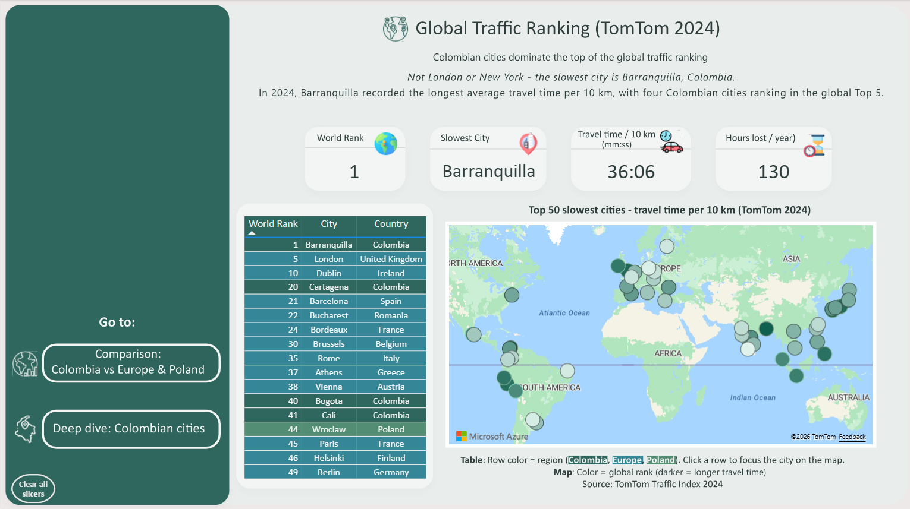
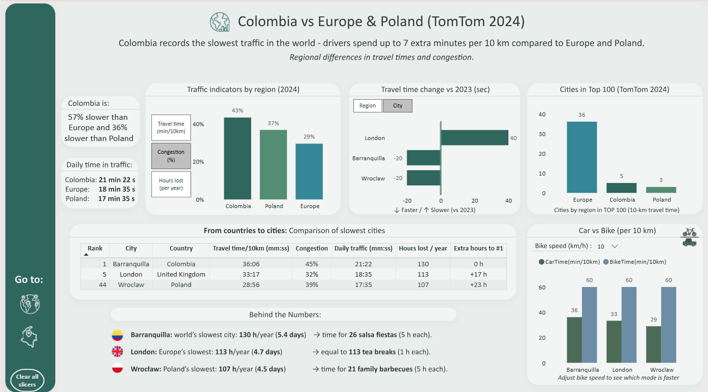
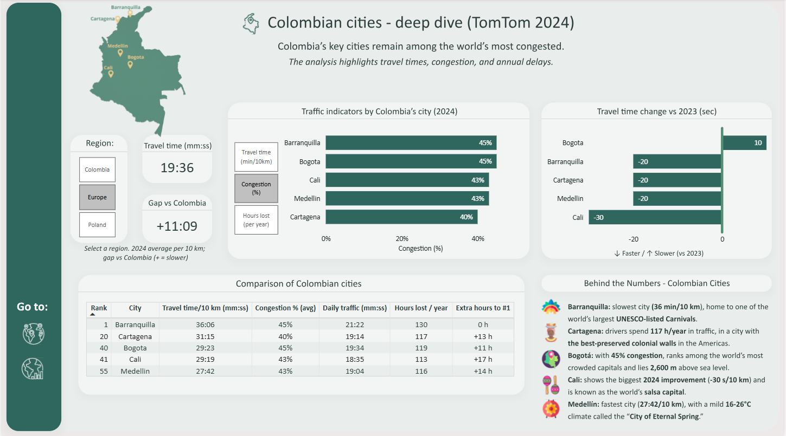

# Analiza ruchu drogowego TomTom 2024

[English version](README.md)

[Zobacz interaktywny raport Power BI](https://app.fabric.microsoft.com/view?r=eyJrIjoiNmE5MDM5ZjYtNTk1Yi00M2VhLWJhYTktYjI2ZDQzMDUyYzBjIiwidCI6IjI3ZWI2YjZjLWRhZWQtNDFkMS05NTJhLTM0ZDY0MjgzZWFhNSJ9&embedImagePlaceholder=true)

## Opis projektu

Projekt przedstawia analizę ruchu drogowego w miastach na całym świecie na podstawie danych **TomTom Traffic Index 2024**. Jego celem jest porównanie czasów przejazdu i poziomów zatłoczenia dróg oraz wskazanie miast, w których występują największe utrudnienia w ruchu.

Analiza koncentruje się przede wszystkim na **Kolumbii**, której miasta zajmują wysokie miejsca w światowym rankingu. Raport prowadzi od perspektywy globalnej, przez porównanie Kolumbii z Europą i Polską, aż po szczegółową analizę pięciu kolumbijskich miast.

## Zbiór danych

Analiza opiera się na danych **TomTom Traffic Index 2024**, obejmujących **501 miast na całym świecie**.

Zbiór danych zawiera:

- pozycję miasta w światowym rankingu,
- średni czas przejazdu 10 km,
- poziom zatłoczenia dróg,
- liczbę godzin traconych rocznie w ruchu drogowym,
- zmianę czasu przejazdu w porównaniu z 2023 rokiem.

## Struktura raportu

Raport składa się z **trzech stron**, które prowadzą od analizy globalnej do szczegółowego spojrzenia na sytuację w Kolumbii.

### 1. Globalny ranking ruchu drogowego

Pierwsza strona przedstawia ogólną sytuację na drogach w miastach na całym świecie, ze szczególnym uwzględnieniem tych, które zajmują najwyższe miejsca w rankingu TomTom Traffic Index 2024.

Interaktywna mapa pokazuje rozmieszczenie geograficzne miast znajdujących się na najwyższych pozycjach rankingu i umożliwia porównanie ich najważniejszych wskaźników ruchu drogowego.

### 2. Kolumbia na tle Europy i Polski

Druga strona koncentruje się na porównaniu **Kolumbii, Europy i Polski**.

Pokazuje różnice w średnim czasie przejazdu 10 km oraz zestawia Kolumbię z wysoko sklasyfikowanymi miastami Europy i Polski, w tym Londynem i Wrocławiem.

### 3. Szczegółowa analiza kolumbijskich miast

Ostatnia strona przedstawia szczegółową analizę pięciu kolumbijskich miast:

**Barranquilla, Cartagena, Bogotá, Cali i Medellín.**

Miasta można porównywać pod względem:

- czasu przejazdu 10 km,
- poziomu zatłoczenia dróg,
- liczby godzin traconych w ruchu drogowym,
- pozycji w światowym rankingu,
- zmiany czasu przejazdu względem 2023 roku.

Dynamiczny selektor umożliwia przełączanie najważniejszych wskaźników w ramach jednego wykresu, a niestandardowe podpowiedzi (tooltips) dostarczają dodatkowych informacji o poszczególnych miastach.

Strona umożliwia również porównanie średniego czasu przejazdu w Kolumbii z odpowiednimi średnimi dla Europy i Polski.

## Najważniejsze wnioski

- Kolumbijskie miasta zajmują wysokie pozycje w światowym rankingu TomTom.
- **Barranquilla** ma najdłuższy średni czas przejazdu 10 km spośród analizowanych kolumbijskich miast.
- Średni czas przejazdu w Kolumbii jest znacznie dłuższy niż średnie dla Europy i Polski.
- W większości analizowanych kolumbijskich miast czas przejazdu skrócił się w porównaniu z 2023 rokiem.
- **Bogotá** była jedynym spośród analizowanych miast, w którym czas przejazdu wydłużył się względem poprzedniego roku.
- **Cali** odnotowało największą poprawę spośród analizowanych miast.

## Funkcjonalności raportu

Projekt obejmuje:

- interaktywne filtry i selektory,
- dynamiczne porównania regionalne,
- możliwość przełączania wskaźników ruchu drogowego,
- autorskie miary DAX,
- niestandardową stronę podpowiedzi (tooltip) ze szczegółowymi danymi o miastach,
- mapy i wizualizacje rankingowe,
- porównania rok do roku,
- elementy narracji analitycznej (data storytelling).

## Wykorzystane narzędzia

- **Power BI**
- **Power Query**
- **DAX**

## Źródło danych

Dane wykorzystane w projekcie pochodzą z **TomTom Traffic Index 2024**.

Źródło: TomTom Traffic Index
